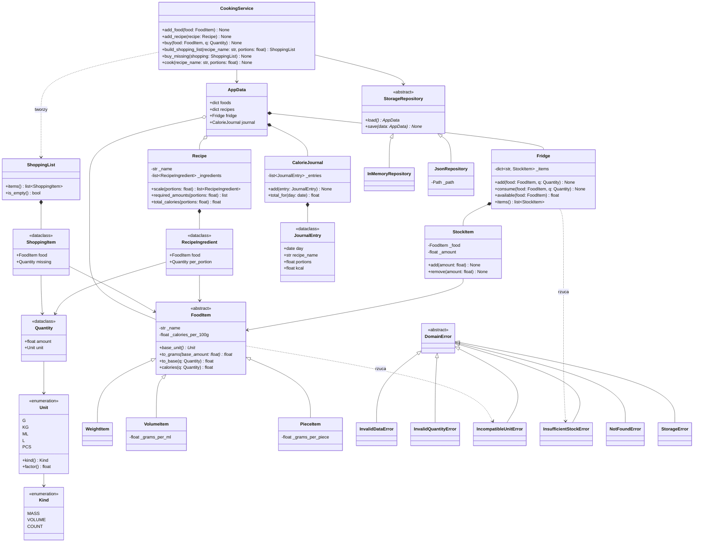

# FridgeManager

Asystent lodówki, przepisów i zakupów. Aplikacja desktopowa w Pythonie z interfejsem graficznym zbudowanym we [Flet](https://flet.dev).

FridgeManager pilnuje, co masz w lodówce, liczy, czego brakuje do wybranego przepisu, i odejmuje składniki po ugotowaniu. Przykład: kupujesz 1 l mleka, przepis zużywa 200 ml, a aplikacja pokazuje, że zostało 800 ml.

> Projekt zaliczeniowy z programowania obiektowego (Python, testy jednostkowe, CI/CD, wydania `v0.1.0`, `v0.2.0`, `v1.0.0`).
> Dokument rośnie razem z projektem. Fragmenty oznaczone 🚧 trzeba uzupełnić lub usunąć przed wydaniem `v1.0.0`.

## Spis treści

- [Funkcje](#funkcje)
- [Szybki start dla użytkownika](#szybki-start-dla-użytkownika)
- [Środowisko deweloperskie](#środowisko-deweloperskie)
- [Uruchomienie aplikacji i testów](#uruchomienie-aplikacji-i-testów)
- [Struktura projektu](#struktura-projektu)
- [Architektura i diagram klas](#architektura-i-diagram-klas)
- [Mapa koncepcji obiektowych](#mapa-koncepcji-obiektowych)
- [CI/CD i wydania](#cicd-i-wydania)
- [Dane aplikacji](#dane-aplikacji)
- [Rejestr użycia LLM](#rejestr-użycia-llm)
- [Autorzy](#autorzy)

## Funkcje

- **Lodówka:** lista produktów z ilościami. Stan rośnie po zakupach i maleje po ugotowaniu przepisu.
- **Produkty:** trzy rodzaje (na wagę, na objętość, na sztuki) z kalorycznością na 100 g.
- **Przepisy:** składniki podawane na 1 porcję, przeliczane na dowolną liczbę porcji.
- **Lista zakupów:** po wybraniu przepisu i liczby porcji aplikacja porównuje wymagania ze stanem lodówki i wypisuje tylko to, czego brakuje.
- **Zakupy:** zatwierdzenie zakupów dodaje brakujące produkty do lodówki.
- **Gotowanie:** „Ugotuj” odejmuje składniki. Jeśli czegoś brakuje, nie zmienia nic i pokazuje, czego brakuje.
- **Kalorie:** dziennik posiłków z sumą kcal dla dnia. 🚧 (wersja `v1.0.0`)
- **Zapis danych:** wszystko zapisuje się w pliku JSON, więc stan lodówki przetrwa zamknięcie aplikacji. 🚧 (wersja `v0.2.0`)

🚧 *Tu wstawić zrzut ekranu aplikacji (np. `docs/screenshot.png`).*

## Szybki start dla użytkownika

Platforma: **Windows 10 / 11 (x64)**. Python nie jest potrzebny.

1. Wejdź w zakładkę [Releases](../../releases) tego repozytorium i pobierz najnowszy plik `FridgeManager-vX.Y.Z-windows.zip`.
2. Rozpakuj archiwum.
3. Uruchom `FridgeManager.exe`.

Windows może pokazać ostrzeżenie SmartScreen, bo program nie jest podpisany certyfikatem. Kliknij **Więcej informacji → Uruchom mimo to**.

## Środowisko deweloperskie

Projekt używa menedżera pakietów **[uv](https://docs.astral.sh/uv/)**. Sam pobiera właściwą wersję Pythona (wskazaną w `.python-version`), tworzy środowisko wirtualne `.venv` i instaluje zależności z `uv.lock`.

### Co zainstalować

| Narzędzie | Po co | Jak |
| :--- | :--- | :--- |
| **Git** | wersjonowanie | [git-scm.com](https://git-scm.com/downloads) |
| **uv** | Python + środowisko + zależności | polecenia poniżej |
| **VS Code** | edytor (zalecany) | [code.visualstudio.com](https://code.visualstudio.com/) |

Instalacja **uv**:

- Windows (PowerShell):
  ```powershell
  powershell -ExecutionPolicy ByPass -c "irm https://astral.sh/uv/install.ps1 | iex"
  ```
- macOS / Linux:
  ```bash
  curl -LsSf https://astral.sh/uv/install.sh | sh
  ```

Po instalacji otwórz nowy terminal i sprawdź:

```bash
git --version
uv --version
```

Na Linuksie okno aplikacji Flet wymaga dodatkowych bibliotek systemowych (m.in. GTK). Lista jest w [dokumentacji Flet](https://flet.dev/docs/getting-started/installation).

### Pobranie projektu i środowiska

```bash
git clone <LINK_DO_REPOZYTORIUM>
cd fridge-manager

# Pobiera Pythona (jeśli trzeba), tworzy .venv i instaluje zależności z uv.lock
uv sync
```

Aktywacja środowiska **nie jest potrzebna**, bo polecenia uruchamiamy przez `uv run`. Gdyby edytor lub terminal tego wymagał:

- Windows (PowerShell): `.venv\Scripts\Activate.ps1`
- Windows (CMD): `.venv\Scripts\activate.bat`
- macOS / Linux: `source .venv/bin/activate`

Po aktywacji przed ścieżką w terminalu pojawia się prefiks `(.venv)`.

> **Wskazówka:** jeśli repozytorium leży w folderze synchronizowanym (np. Google Drive), lepiej trzymać `.venv` poza nim. Przed `uv sync` ustaw ścieżkę, np. w PowerShellu:
> ```powershell
> $env:UV_PROJECT_ENVIRONMENT = "C:\venvs\fridge-manager"
> ```

### VS Code (zalecane)

Otwórz folder projektu (`File → Open Folder`) i zainstaluj rozszerzenia:

- **Python** i **Pylance** (Microsoft),
- **Even Better TOML** (czytelny `pyproject.toml`),
- **Markdown Preview Mermaid Support** (diagramy w podglądzie `.md`).

Wybierz interpreter z projektu: `Ctrl+Shift+P → Python: Select Interpreter → .venv`.

### Dodawanie bibliotek

```bash
uv add <nazwa_pakietu>          # zależność programu
uv add --dev <nazwa_pakietu>    # zależność tylko do rozwoju (testy, narzędzia)
```

Zacommituj razem `pyproject.toml` i `uv.lock`. Druga osoba po `git pull` aktualizuje środowisko poleceniem `uv sync`.

## Uruchomienie aplikacji i testów

| Co | Polecenie |
| :--- | :--- |
| Uruchomienie aplikacji (z odświeżaniem po zmianie kodu) | `uv run flet run src/main.py` |
| Uruchomienie aplikacji bez odświeżania | `uv run python src/main.py` |
| Testy jednostkowe | `uv run pytest` |
| Testy z raportem pokrycia 🚧 | `uv run pytest --cov=src/fridge_manager/domain` |
| Zbudowanie pliku `.exe` lokalnie (tylko Windows) | `uv run flet pack src/main.py --name FridgeManager --yes` |

Testy sprawdzają logikę z warstwy domenowej i zapisu danych. Interfejs graficzny jest cienką warstwą nad nią i nie jest testowany jednostkowo.

## Struktura projektu

```text
fridge-manager/
├── .github/workflows/
│   ├── test.yml            # testy przy pushu do main
│   └── release.yml         # paczka i wydanie po tagu vX.Y.Z
├── docs/
│   ├── PRZEWODNIK_DEWELOPERA.md
│   └── WYMAGANIA_PROJEKTU.md
├── src/
│   ├── main.py             # punkt wejścia aplikacji Flet
│   └── fridge_manager/
│       ├── domain/         # logika biznesowa (bez Flet, bez print/input, bez plików)
│       ├── storage/        # zapis i odczyt danych (JSON, pamięć)
│       └── ui/             # widoki Flet (cienka warstwa)
├── tests/                  # testy pytest
├── pyproject.toml
├── uv.lock
└── .python-version
```

Zasada zależności: `ui → storage → domain`, a `domain` nie zna nikogo. Dzięki temu logikę da się testować bez uruchamiania okna i bez dysku.

## Architektura i diagram klas

Cała logika siedzi w pakiecie `domain/`. Klasa `CookingService` łączy ją z zapisem danych przez abstrakcję `StorageRepository`, a widoki Flet wywołują tylko metody serwisu.



🚧 *Po `v1.0.0` sprawdzić, czy diagram odpowiada kodowi (nazwy klas i metod).*

## Mapa koncepcji obiektowych

Projekt wykorzystuje wszystkie 6 koncepcji. Poniżej wskazane są klasy, pliki i powód użycia.

| Koncepcja | Klasy i pliki | Uzasadnienie |
| :--- | :--- | :--- |
| **Hermetyzacja** | `Fridge._items`, `StockItem._amount` (`domain/fridge.py`); `CalorieJournal._entries` (`domain/journal.py`); `Quantity` jako niemutowalna (`domain/quantity.py`) | Stan jest prywatny (konwencja `_atrybut` + właściwości tylko do odczytu). Ilość zmienia się wyłącznie przez `add()` i `consume()`, które pilnują, żeby nie spadła poniżej zera i żeby jednostki pasowały. Nikt z zewnątrz nie może zostawić lodówki w niespójnym stanie. |
| **Abstrakcja** | `FoodItem` (`domain/food.py`), `StorageRepository` (`domain/repository.py`), obie jako `abc.ABC` | `Fridge`, `Recipe` i `CookingService` pracują na ogólnym `FoodItem`, a nie na konkretnym rodzaju produktu. `CookingService` zależy od `StorageRepository`, więc nie wie, czy dane trafiają do pliku, czy do pamięci (testy). |
| **Dziedziczenie** | `WeightItem`, `VolumeItem`, `PieceItem` po `FoodItem` (`domain/food.py`); `DomainError` i jego potomkowie (`domain/errors.py`); `InMemoryRepository`, `JsonRepository` po `StorageRepository` (`storage/`) | Rodzaje produktów różnią się danymi (gęstość, masa sztuki) i sposobem przeliczania na gramy. Hierarchia wyjątków pozwala interfejsowi łapać jeden typ bazowy `DomainError`. |
| **Polimorfizm** | `FoodItem.base_unit` i `FoodItem.to_grams()` nadpisywane w klasach pochodnych; wywołania w `Fridge`, `Recipe`, `CookingService`; `StorageRepository.load()/save()` | Ten sam kod liczy ilości i kalorie dla mleka (ml), mąki (g) i jajek (szt.), bo każda klasa sama wie, jak przeliczyć swoją ilość. Dodanie nowego rodzaju produktu nie wymaga zmian w `Fridge` ani w przepisach. |
| **Kompozycja** | `Recipe` → `RecipeIngredient` → `Quantity`; `Fridge` → `StockItem`; `ShoppingList` → `ShoppingItem`; `AppData` składa lodówkę, przepisy i dziennik (`domain/`) | Obiekty są zbudowane z innych obiektów, nie dziedziczą po sobie. Przepis *ma* składniki, lodówka *ma* pozycje magazynowe. |
| **Obsługa błędów** | `InvalidDataError`, `InvalidQuantityError`, `IncompatibleUnitError`, `InsufficientStockError`, `NotFoundError`, `StorageError` (`domain/errors.py`); przechwytywane w `ui/` | Własne wyjątki zamiast `ValueError` i `print`. Domena je rzuca, interfejs łapie `DomainError` i pokazuje czytelny komunikat. Uszkodzony plik JSON kończy się `StorageError`, a nie zawieszeniem programu. |

🚧 *Przed `v1.0.0` zweryfikować, czy nazwy plików i klas w tabeli zgadzają się z repozytorium.*

## CI/CD i wydania

Konfiguracja leży w `.github/workflows/`.

- **`test.yml`:** przy każdym pushu do `main` (oraz przy pull requestach do `main`) instaluje środowisko (`uv sync --locked`) i uruchamia `uv run pytest`. Czerwony pipeline na `main` oznacza błąd do naprawienia.
- **`release.yml`:** uruchamia się wyłącznie po wypchnięciu tagu `vX.Y.Z`. Sprawdza, czy tag zgadza się z wersją w `pyproject.toml`, uruchamia testy, buduje `FridgeManager.exe` (`flet pack`), pakuje go do `FridgeManager-vX.Y.Z-windows.zip` i publikuje jako wydanie w GitHub Releases.

Wydania: `v0.1.0`, `v0.2.0` (pośrednie) i `v1.0.0` (końcowe). Każda paczka jest budowana przez pipeline, nie ręcznie.

Jak wydać nową wersję:

```bash
# 1. podnieś version w pyproject.toml, zacommituj i wypchnij na main (pipeline testowy musi być zielony)
# 2. oznacz commit tagiem i wypchnij tag
git tag v0.1.0
git push origin v0.1.0
```

## Dane aplikacji

Aplikacja zapisuje stan w pliku JSON, poza folderem programu i poza repozytorium:

| System | Domyślna ścieżka |
| :--- | :--- |
| Windows | `%APPDATA%\FridgeManager\data.json` |
| macOS / Linux | `~/.fridge_manager/data.json` |

Własną ścieżkę można ustawić zmienną środowiskową `FRIDGE_MANAGER_DATA` (przydatne w testach i do trzymania osobnych zestawów danych).

🚧 *Dotyczy wersji `v0.2.0` i nowszych.*

## Rejestr użycia LLM

Każde użycie modelu językowego (kod, testy, dokumentacja, konfiguracja) jest oznaczone w opisie commita (stopka `LLM: ...`) i w poniższej tabeli. W kolumnie ostatniej wpisujemy, czy kod został użyty bez zmian, zmieniony po wygenerowaniu, czy model tylko doradzał, a kod napisaliśmy sami, oraz jak to zweryfikowaliśmy.

| Plik / fragment | Narzędzie | Do czego użyto i jak zweryfikowano |
| :--- | :--- | :--- |
| 🚧 `src/fridge_manager/domain/fridge.py`, `Fridge.consume()` *(przykład, zastąpić prawdziwymi wpisami)* | Claude | wygenerowany szkielet; zmieniono obsługę zerowej ilości, dopisano 4 testy brzegowe ręcznie |
| 🚧 `docs/README.md` *(przykład)* | Claude | wygenerowany szkic dokumentacji; poprawiono nazwy klas i ścieżki zgodnie z kodem |

## Autorzy

- Jan Habdas (https://github.com/mryanstein)
- Małgorzata Hycnar (https://github.com/mhycnar)

