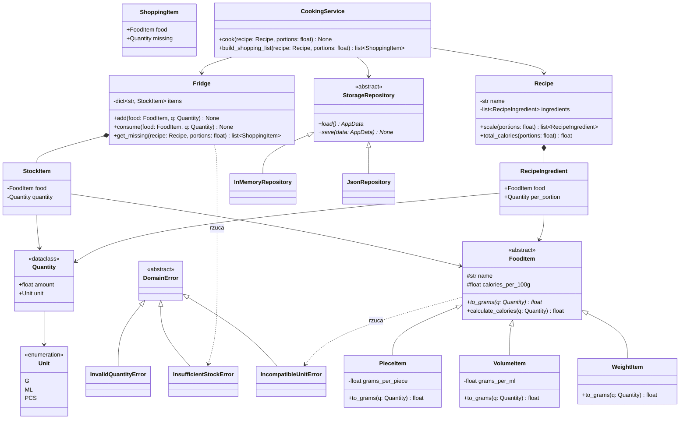

## 🛠️ Instalacja i konfiguracja środowiska

Projekt wykorzystuje menedżer pakietów **[uv](https://docs.astral.sh/uv/)**. Środowisko wirtualne `.venv` tworzy się **w folderze projektu** (jest w `.gitignore`, więc nie trafia do repozytorium).

### Wymagania wstępne
* Zainstalowany **Python 3.10+**
* Zainstalowany **Git**
* Zainstalowane narzędzie **uv** (jeśli nie masz, instalacja jednym poleceniem):
  * **Windows (PowerShell):**
    ```powershell
    powershell -ExecutionPolicy ByPass -c "irm https://astral.sh/uv/install.ps1 | iex"
    ```
  * **macOS / Linux:**
    ```bash
    curl -LsSf https://astral.sh/uv/install.sh | sh
    ```

### 1. Pobranie projektu i utworzenie środowiska

```bash
git clone <LINK_DO_REPOZYTORIUM>
cd fridge-manager

# Tworzy .venv w folderze projektu i instaluje zależności z pyproject.toml / uv.lock
uv sync
```

Aktywacja środowiska **nie jest potrzebna**, bo polecenia uruchamiamy przez `uv run`. Jeśli edytor lub terminal wymaga aktywacji, służy do tego:

* **Windows (PowerShell):** `.venv\Scripts\Activate.ps1`
* **Windows (CMD):** `.venv\Scripts\activate.bat`
* **macOS / Linux:** `source .venv/bin/activate`

*(Po aktywacji przed ścieżką w terminalu pojawi się prefiks `(.venv)`).*

> [!tip] Środowisko poza folderem projektu
> Jeśli repozytorium leży w folderze synchronizowanym (np. Google Drive), lepiej trzymać `.venv` osobno, żeby nie synchronizować tysięcy plików. Wtedy przed `uv sync` ustaw ścieżkę, np. w PowerShellu:
> ```powershell
> $env:UV_PROJECT_ENVIRONMENT = "C:\venvs\fridge-manager"
> ```

### 2. Uruchomienie aplikacji i testów

* **Uruchomienie aplikacji (interfejs tekstowy w terminalu):**
  ```bash
  uv run python -m fridge_manager
  ```
* **Uruchomienie testów jednostkowych:**
  ```bash
  uv run pytest
  ```

### Dodawanie nowych bibliotek (dla zespołu)
Program korzysta tylko z biblioteki standardowej Pythona, a `pytest` jest zależnością deweloperską. Jeśli dodajesz kolejną paczkę:
```bash
uv add <nazwa_pakietu>        # zależność programu
uv add --dev <nazwa_pakietu>  # zależność tylko do rozwoju (np. pytest)
```
Zacommituj razem `pyproject.toml` i `uv.lock`. Druga osoba po `git pull` aktualizuje środowisko poleceniem:
```bash
uv sync
```

---

## Asystent lodówki, przepisów i zakupów

> [!abstract] Główna idea
> Prosta aplikacja w Pythonie z interfejsem tekstowym w terminalu. Śledzi stan produktów w lodówce, dopasowuje je do wybranych przepisów na określoną liczbę porcji, generuje listę brakujących zakupów oraz zlicza kalorie po spożyciu posiłku.

**Stos:** Python 3.10+, pytest, uv, GitHub Actions. **Platforma:** terminal (Windows / macOS / Linux). **Interfejs:** najprostszy możliwy, menu tekstowe w pętli (`input()` / `print()`), bez frameworków graficznych.

### 🎯 Główne funkcje (MVP → Rozwój)

- [ ] **Zarządzanie lodówką (Inventory):** dodawanie produktów z ilością, jednostką (g, ml, szt.) i kalorycznością na 100 g.
- [ ] **Baza przepisów:** definiowanie składników potrzebnych na 1 porcję (np. Spaghetti Bolognese).
- [ ] **Kalkulator braków i lista zakupów:** wybór przepisu + liczby porcji → porównanie ze stanem lodówki → lista zakupów wypisana w terminalu (opcjonalnie zapis do pliku tekstowego).
- [ ] **Konsumpcja (Gotuję / Jem):** zatwierdzenie posiłku odejmuje składniki z lodówki i zapisuje kcal w dzienniku.
- [ ] **Przelicznik jednostek i kalorii:** opakowanie → gramy, szklanka → ml, podsumowanie kcal (tylko kcal, bez makro).

**Menu aplikacji (szkic):**

```text
1. Pokaż lodówkę
2. Dodaj produkt
3. Dodaj przepis
4. Lista zakupów dla przepisu
5. Ugotuj przepis
6. Dziennik kalorii
0. Wyjście
```

### ✅ Decyzje projektowe

- Dane lodówki i przepisów zapisuję w **JSON** (plik `data.json`) przez `load()` / `save()` w repozytorium. Lista zakupów i dziennik są tylko wyjściem tekstowym.
- **Bez `MealPlan`.** Kompozycję pokazują `Recipe` → `RecipeIngredient` i `Fridge` → `StockItem`.
- Zakres kalorii: tylko **kcal**.
- Interfejs jest **cienką warstwą** nad domeną. Cała logika siedzi w klasach, a menu tylko je wywołuje.
- Program nie ma zależności zewnętrznych, więc paczka z wydania uruchamia się na czystym Pythonie 3.10+.

---

### 🏗️ Architektura i koncepcje OOP

> [!warning] Zasada czystej domeny
> Pakiet `fridge_manager/domain/` **nie może** używać `input()` ani `print()` i **nie może** importować niczego z `cli.py`. Dzięki temu cała logika biznesowa jest testowalna w pytest bez symulowania terminala. Importy w kierunku domeny, a nie z domeny, można pilnować przeglądem kodu lub testem sprawdzającym importy.

```text
src/fridge_manager/
  domain/            # Quantity, FoodItem, Fridge, Recipe, errors, StorageRepository, CookingService
  json_repository.py # JsonRepository (zapis i odczyt data.json)
  cli.py             # menu tekstowe (cienka warstwa)
  __main__.py        # uruchamia cli.main()
tests/               # testy domeny (pytest)
.github/workflows/
pyproject.toml
uv.lock
```

#### Wykorzystanie OOP (5 z 6, wymagane min. 3)

| Koncepcja | Gdzie w projekcie | Uzasadnienie |
| :--- | :--- | :--- |
| **1. Hermetyzacja** | `Fridge`, `StockItem` (`domain/fridge.py`) | Prywatny stan produktów (atrybut `_items` z podkreśleniem, dostęp przez właściwości tylko do odczytu). Zmiana ilości tylko przez `add()` i `consume()`, które pilnują, by ilość nie spadła poniżej zera i nie była ujemna. |
| **2. Abstrakcja** | `StorageRepository` (`abc.ABC`), `FoodItem` (klasa abstrakcyjna) | `CookingService` zależy od abstrakcji, nie od sposobu zapisu. W testach `InMemoryRepository`, w produkcji `JsonRepository`. |
| **3. Dziedziczenie + polimorfizm** | `FoodItem` → `WeightItem`, `VolumeItem`, `PieceItem`; `DomainError` → `InsufficientStockError`, `IncompatibleUnitError`, `InvalidQuantityError` | Każdy typ produktu inaczej przelicza ilość na gramy (`to_grams`), a kalorie liczy wspólna metoda bazowa. Kod obsługujący lodówkę i przepisy operuje na typie `FoodItem`. |
| **4. Kompozycja** | `Recipe` → `RecipeIngredient`; `Fridge` → `StockItem`; `ShoppingList` → `ShoppingItem` | Obiekty zbudowane z obiektów, nie dziedziczą po sobie. |
| **5. Obsługa błędów** | `domain/errors.py` | Własne wyjątki rzucane przy zużyciu większej ilości niż w lodówce, mieszaniu jednostek bez przelicznika albo ujemnych porcjach. Interfejs tekstowy je przechwytuje i wyświetla czytelny komunikat. |

> [!note] Co sprawia, że hierarchia `FoodItem` nie jest sztuczna
> Różnice są realne: `PieceItem` potrzebuje `grams_per_piece`, `VolumeItem` gęstości, `WeightItem` nic. Metoda `calculate_calories` jest w klasie bazowej (wzorzec metody szablonowej) i korzysta z abstrakcyjnej `to_grams`.

#### Diagram klas



---

### 🧪 Plan testów

- Uruchamianie jednym poleceniem: `uv run pytest` (zwykłe `pytest` przy aktywnym `.venv`).
- Testy obejmują każdą klasę domenową, także klasy wyjątków (`pytest.raises`, `isinstance`, komunikaty).
- Interfejs tekstowy (`cli.py`) jest cienki i nie jest testowany jednostkowo, ale jego działanie pokazuję na prezentacji.

**Przypadki brzegowe:**
- [ ] ujemne i zerowe porcje, ułamki porcji,
- [ ] zużycie dokładnie całej ilości (zostaje 0),
- [ ] błędy zmiennoprzecinkowe (0.1 + 0.2), porównania przez `pytest.approx` / `math.isclose` albo liczenie w gramach,
- [ ] mieszanie jednostek bez przelicznika → `IncompatibleUnitError`,
- [ ] produkt w ilości 0 i brak produktu w lodówce,
- [ ] przepis ze składnikiem spoza bazy,
- [ ] `InMemoryRepository`: zapis i odczyt zwraca ten sam stan,
- [ ] `JsonRepository`: zapis i odczyt z pliku tymczasowego (`tmp_path`).

---

### ⚙️ Pipeline CI/CD

- [ ] **`.github/workflows/test.yml`:** `on: push: branches: [main]`, kroki: `actions/checkout`, `astral-sh/setup-uv`, `uv sync --locked`, `uv run pytest`.
- [ ] **`.github/workflows/release.yml`:** `on: push: tags: ['v*.*.*']`, `permissions: contents: write`, kroki: `uv sync --locked`, `uv run pytest`, wpisanie wersji z tagu do `pyproject.toml`, spakowanie `src/`, `README.md` i `pyproject.toml` do `fridge-manager-vX.Y.Z.zip`, publikacja w GitHub Releases.
- [ ] **`.gitignore`:** `.venv`, `__pycache__`, `.pytest_cache`, `data.json`, pliki IDE.
- [ ] **README, uruchomienie z paczki:** rozpakuj zip i uruchom `python -m fridge_manager` z folderu `src` (wymagany Python 3.10+, bez dodatkowych bibliotek).

---

### 📅 Kamienie milowe (Wydania na UPeL)

#### 🏷️ `v0.1.0` — Fundamenty i pionowy przekrój
- [ ] Inicjalizacja repozytorium (`.gitignore`, `pyproject.toml`, `src/fridge_manager/domain`, `tests/`).
- [ ] **Pusty program z jednym poleceniem menu, spakowany i wydany przez pipeline** (wykrywa problemy z paczką jak najwcześniej).
- [ ] `Quantity`, `FoodItem` + 3 klasy pochodne, `Fridge`, `StockItem`, wyjątki.
- [ ] Pierwsze testy w pytest i zielony pipeline na `main`.
- [ ] Opcja menu wyświetlająca stan lodówki.

#### 🏷️ `v0.2.0` — Przepisy, zakupy i konsumpcja
- [ ] `Recipe`, `RecipeIngredient`, `scale()`.
- [ ] `StorageRepository` + `InMemoryRepository` + `JsonRepository` (`load()` / `save()`).
- [ ] `CookingService`: lista zakupów wypisywana w terminalu, „Ugotuj przepis" odejmujący składniki i walidujący braki.
- [ ] Opcje menu do dodawania produktów i wyboru porcji.
- [ ] Rozbudowa testów o przypadki brzegowe z listy wyżej.

#### 🏷️ `v1.0.0` — Kalorie, polerka i dokumentacja końcowa
- [ ] Kalkulator kcal i dziennik spożytych posiłków.
- [ ] Pełny `README.md`: opis, uruchomienie z paczki, uruchomienie testów, diagram Mermaid, tabela OOP, rejestr LLM.
- [ ] Sprawdzenie paczki pobranej z GitHub Releases na czystym komputerze lub folderze przed prezentacją.

---

### ⚠️ Ryzyka

- [ ] **Pipeline wydania i paczka** bywają trudniejsze niż same klasy, dlatego pionowy przekrój w `v0.1.0`.
- [ ] **Rozrastający się interfejs** to pułapka. Trzymam menu tekstowe minimalne, a logikę w domenie.
- [ ] **Hierarchia `FoodItem`** musi mieć realnie różne zachowanie (`to_grams`), inaczej to klasy do odhaczenia.
- [ ] **Hermetyzacja w Pythonie** opiera się na konwencji (`_atrybut`, właściwości), więc w README trzeba jasno wskazać, które pola są prywatne i dlaczego.

---

### 🤖 Checklista zasad z sylabusa (żeby nie stracić punktów)

- [ ] **Małe, spójne commity** od samego początku (nie wrzucać wszystkiego jednym commitem!).
- [ ] **Oznaczanie LLM w każdym commicie**, gdzie pomagało AI (stopka na końcu wiadomości commita):
  ```text
  LLM: Claude; wygenerowano szkielet klasy Fridge, ręcznie dodano walidację jednostek i testy
  ```
- [ ] **Rejestr użycia LLM w `README.md`** (tabela: plik → narzędzie → co zrobiło i jak zweryfikowano; czy kod użyty bez zmian, zmieniony, czy tylko porada).
- [ ] **Testy uruchamiane jednym poleceniem** (`uv run pytest`) i zielony pipeline na `main`.
- [ ] **Umiem wyjaśnić i zmodyfikować każdy fragment kodu** (także wygenerowany).

## Projekt programistyczny – wymagania

Celem projektu jest samodzielne przeprowadzenie małego projektu programistycznego od pustego repozytorium do wydanej wersji. Obejmuje to kod produkcyjny, testy, dokumentację i automatyczny proces budowania. Projekt może być napisany w **dowolnym języku**, który wspiera programowanie obiektowe. Temat wybierasz samodzielnie.

|   |   |
|---|---|
|**Zgłoszenie tematu**|tytuł i link do repozytorium oraz ewentualnie lista współpracowników w aktywności|
|**1. wersja pośrednia**|tag np. `v0.1.0`, paczka wgrana na UPeL|
|**2. wersja pośrednia**|tag np. `v0.2.0`, paczka wgrana na UPeL|
|**Wersja końcowa**|tag `v1.0.0`, paczka wgrana na UPeL, następnie prezentacja projektu|

### 1. Koncepcje obiektowe

Projekt musi w uzasadniony sposób wykorzystywać **co najmniej 3 z 6** poniższych koncepcji. Klasa, która istnieje tylko po to, żeby „odhaczyć” wymaganie, się nie liczy.

1. **Hermetyzacja.** Stan obiektów jest prywatny, a zmienia się go wyłącznie przez metody, które pilnują poprawności danych.
2. **Abstrakcja.** Co najmniej jeden interfejs lub klasa abstrakcyjna, która jest wykorzystywana do realizacji funkcjonalności.
3. **Dziedziczenie.** Co najmniej jedna hierarchia z dwiema lub więcej klasami pochodnymi.
4. **Polimorfizm.** Obiekty różnych klas obsługiwane przez wspólny typ bazowy (wywołania metod wirtualnych lub interfejsu).
5. **Kompozycja.** Obiekty zbudowane z innych obiektów, nie tylko przez dziedziczenie.
6. **Obsługa błędów.** Własne wyjątki lub inny jawny mechanizm sygnalizowania błędów, stosowany konsekwentnie.

Każdą wykorzystaną koncepcję **opisz** w dokumentacji (odrębne _docs/_ lub _Readme.md_): wskaż klasy i pliki, w których ją zastosowano, i wyjaśnij, dlaczego jest tam potrzebna (sekcja 4).

### 2. Repozytorium i praca z Gitem

- Repozytorium na GitHubie lub GitLabie, publiczne albo z dostępem dla prowadzącego.
- Historia zaczyna się od pustego repozytorium i pokazuje rzeczywisty przebieg pracy. Projekt wrzucony jednym commitem nie zostanie przyjęty.
- Commity są małe i spójne, a ich opisy mówią, _co_ i _dlaczego_ się zmieniło.
- Plik `.gitignore`, a w repozytorium brak plików wynikowych kompilacji, plików IDE i danych wrażliwych (haseł, tokenów).
- Przy pracy zespołowej historia commitów pokazuje wkład każdej osoby.

### 3. Testy

- Automatyczne testy jednostkowe w frameworku właściwym dla języka (np. GoogleTest lub Catch2 dla C++, JUnit dla Javy, pytest dla Pythona).
- Testy obejmują logikę każdej klasy z warstwy domenowej, w tym przypadki brzegowe i błędne dane.
- Testy uruchamia się jednym poleceniem opisanym w README, a pipeline uruchamia je automatycznie dla gałęzi głównej.

### 4. Dokumentacja

Plik `README.md` w katalogu głównym repozytorium lub inaczej zorganizowana dokumentacja (np. _docs/_) zawiera:

1. opis projektu i jego funkcji,
2. instrukcję budowania, uruchomienia i uruchomienia testów,
3. **diagram klas** (np. w Mermaid lub PlantUML albo jako obraz),
4. **mapę koncepcji obiektowych**: tabelę „koncepcja → klasy i pliki → uzasadnienie” dla każdej z wykorzystanych koncepcji (co najmniej 3),
5. **rejestr użycia LLM** (sekcja 6).

### 5. Pipeline CI/CD

- **Pipeline testowy** uruchamia się przy każdym pushu do **gałęzi głównej** (`main` lub `master`): buduje projekt i uruchamia testy. Czerwony pipeline na gałęzi głównej oznacza błąd do naprawienia. Na pozostałych gałęziach pipeline nie jest wymagany.
- **Pipeline wydania** uruchamia się **wyłącznie** dla commitów oznaczonych tagiem wersji w formacie `vX.Y.Z` ([wersjonowanie semantyczne](https://semver.org/lang/pl/)). Buduje paczkę z gotowym programem i publikuje ją jako wydanie (GitHub Releases lub GitLab Releases). Nazwa paczki zawiera numer wersji.
- Paczka zawiera program gotowy do uruchomienia na wskazanej w README platformie: plik wykonywalny, archiwum, pakiet albo obraz kontenera.
- Wymagane są co najmniej **trzy wydania**: dwa pośrednie (np. `v0.1.0`, `v0.2.0`) i jedno końcowe `v1.0.0`. Każde ma paczkę zbudowaną przez pipeline, a nie dodaną ręcznie.
- Paczkę z **każdego z trzech wydań** pobierz z wydania w repozytorium i wgraj na UPeL do odpowiedniego zadania w terminie z harmonogramu.
- Konfiguracja pipeline'u jest częścią repozytorium (`.github/workflows/` lub `.gitlab-ci.yml`).

### 6. Korzystanie z LLM i innych narzędzi

Możesz korzystać z dowolnych narzędzi, także z modeli językowych (ChatGPT, Claude, Copilot itp.). Każde użycie LLM przy tworzeniu kodu, testów, dokumentacji lub konfiguracji musi być **jawnie oznaczone** w dwóch miejscach.

**a) W commicie** – na końcu opisu dodaj stopkę (jedną na każde narzędzie):

```
Dodaj walidację danych w klasie Rezerwacja

LLM: Claude; szkielet Rezerwacja::waliduj() wygenerowany, obsługa dat zmieniona, testy dopisane ręcznie
```

**b) W dokumentacji** – rejestr użycia LLM w README:

|Plik / fragment|Narzędzie|Do czego użyto i jak zweryfikowano|
|---|---|---|
|`src/Rezerwacja.cpp`, `waliduj()`|Claude|wygenerowany szkielet walidacji; zmieniono obsługę dat, dopisano 4 testy brzegowe|

Opis powinien jasno mówić, czy LLM wygenerował kod, który został użyty bez zmian, wygenerował kod, który później zmieniłeś, czy tylko doradzał (wyjaśnienie, przegląd, podpowiedź), a kod napisałeś samodzielnie.

Ważne

Odpowiadasz za cały kod w repozytorium, niezależnie od tego, kto lub co go napisało. Podczas prezentacji musisz umieć wyjaśnić i zmodyfikować każdy fragment. Nieoznaczone użycie LLM jest traktowane jak niesamodzielna praca. Samo oznaczone użycie LLM nie obniża oceny.

### 7. Oddanie i prezentacja

- Oceniany jest stan repozytorium w commicie oznaczonym tagiem `v1.0.0` i paczka zbudowana z tego tagu, wgrana na UPeL.
- Podczas prezentacji pokazujesz działający program uruchomiony z paczki wydania, omawiasz pomysł,  architekturę i odpowiadasz na pytania.
